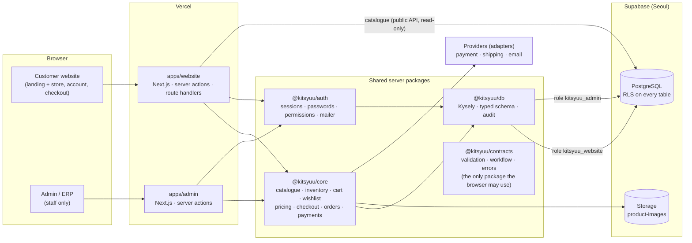
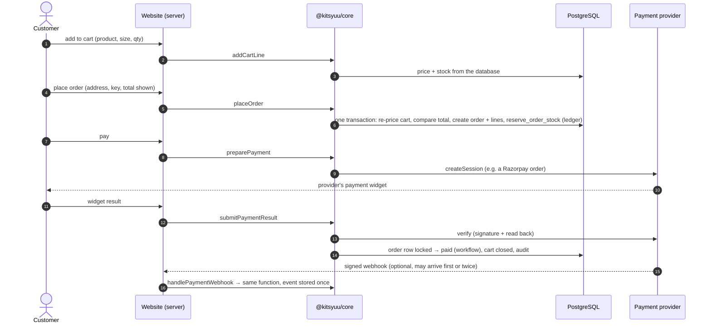

# KITSYUU platform architecture

KITSYUU is an e-commerce store plus an ERP / business-management back office, built as one platform:

- two independently deployable Next.js applications: the **customer website** and the **Admin/ERP**;
- shared **server-only packages** with the business logic;
- one **PostgreSQL database** (Supabase, Seoul) with a separate database role for each application.

This document describes the platform as of **M7 (core commerce)**, plus **M8 (ERP operations), which exists only locally** on the `m8-operations` branch and is not deployed. For the list of milestones, see the [README](../README.md#status).

## Contents

- [Principles](#principles)
- [System overview](#system-overview)
- [Repository layout](#repository-layout)
- [Database and security model](#database-and-security-model)
- [Authentication](#authentication)
- [Commerce (M7)](#commerce-m7)
- [Order workflow](#order-workflow)
- [ERP operations (M8, local only)](#erp-operations-m8-local-only)
- [Providers and configuration](#providers-and-configuration)
- [Deployment](#deployment)
- [Changing the database safely](#changing-the-database-safely)
- [Business decisions](#business-decisions)

## Principles

- **Business logic lives in `packages/core`.** Pages and server actions validate the input, check the session and call a service. They never query the database for a business operation themselves.
- **Never trust the browser.** Prices, stock, totals and payment results are always worked out or verified on the server.
- **External services are adapters.** Payments, shipping, email, storage, tax and discounts sit behind interfaces. A provider plugs in without changing checkout or orders.
- **No invented business rules.** When a business value has not been decided (for example shipping charges or tax rules), the platform leaves it unset and configurable. It does not guess a number. Decided values live in configuration (see [Business decisions](#business-decisions)).
- **Workflows are configuration.** The order status transitions are declared in one place, per actor. The UI asks the business layer what is allowed.
- **Every important change is audited** in the same transaction as the change (`audit_logs`, append-only).

## System overview

- The **customer website** serves `/` as a single page: the brand landing film, then the store (`#store`). Catalogue pages are statically generated. The header learns the signed-in state from `/api/me`, and a signed-in customer's cart and wishlist from `/api/store`.
- The **Admin/ERP** is a separate app with staff accounts, roles and permissions. It is never served from the customer website.
- The **catalogue** on the website is read through Supabase's public API (row-level security shows only active products). Everything else, including customer data, carts and orders, goes through the website's own database role.

## Repository layout

| Path | Contents |
|---|---|
| `apps/website` | Customer website (Next.js 16): landing + store, customer accounts, cart, wishlist, checkout, payment step, order confirmation |
| `apps/admin` | Admin/ERP (Next.js 16): dashboard, catalogue, variants, images, inventory, orders, staff, roles, audit |
| `packages/core` | Business services (see [packages/core/README.md](../packages/core/README.md)) |
| `packages/auth` | Staff and customer authentication, permissions, mailer |
| `packages/db` | Database access (Kysely), typed schema, audit writer |
| `packages/contracts` | Input validation (zod), order workflow, error types |
| `database/migrations` | Numbered SQL migrations, applied in order, tracked in `app_private.applied_migrations` |
| `database/scripts` | Migration, snapshot and verification tooling |
| `database/test` | Local test-database shim and order fixtures (never used against Supabase) |
| `dist/` | The original static site; its landing assets are copied into the website at build time |

## Database and security model

- **Two application roles.**
  - `kitsyuu_website` has only what the store needs: the catalogue read-only; customers, sessions, addresses, carts, wishlists, orders and payments. It can append to the audit log as `customer` or `system` only.
  - `kitsyuu_admin` has what the ERP needs.
  - Both connect through the Supabase pooler with their own passwords, kept in each app's environment.
- **Row-level security on every table.** On Supabase, the public API roles (`anon`, `authenticated`) receive default table grants, so RLS is the barrier. Every new table enables RLS, and every new function revokes EXECUTE from those roles explicitly.
- **Stock changes only through `public.adjust_stock()`.** It locks the size, refuses to go below zero, and writes the stock ledger row (`inventory_movements`) in the same transaction. A trigger rejects any other change to `stock_qty`.
  - The website role cannot call `adjust_stock()`. M7 gives it two narrow functions: `reserve_order_stock(order)` and `release_order_stock(order)`. They take or return exactly the stock of one order, and only in the right order state.
- **Money** is integer paise. Order amounts are a snapshot, never edited afterwards. How they were worked out (tax rate, shipping method, discounts) is kept in `orders.pricing`.
- **The audit log is append-only**: no role can update or delete it, and a trigger blocks it for everyone.

## Authentication

| | Customers (M6) | Staff (M3) |
|---|---|---|
| Passwords | Argon2id | Argon2id |
| Session | Random 256-bit token in a `__Host-` HttpOnly, Secure, SameSite=Lax cookie. The database stores only its SHA-256. | Same design, separate table |
| Lifetime | Idle and absolute limits from `settings` (`auth.*`) | Idle and absolute limits from `settings` |
| Protection | Per-email and per-IP throttling, no account enumeration, single-use email links | Same, plus invitations, roles and permissions |
| Legacy | Accounts created in Supabase Auth move to platform login on their next login ("verify-on-login"). Supabase Auth is not switched off. | — |

Every page and action re-checks the session on the server. `proxy.ts` only sends visitors without a cookie to the login page early.

## Commerce (M7)

- **Cart.**
  - A guest's cart and wishlist stay in the browser (`localStorage`).
  - After login they are merged once into the customer's database cart and wishlist, then cleared from the browser.
  - The browser only ever says which product, size and quantity. Names, prices, stock and totals are resolved by `priceCart()`, the same function for the cart page, the checkout page and order creation.
- **Tamper and stale checks.** The checkout form carries the total the customer saw (`expectedTotalPaise`). If the server's total differs, the order is refused and nothing is written.
- **Idempotency.**
  - The checkout form carries a random key, so submitting it twice returns the same order.
  - A provider payment id is stored once, and an order is marked paid once.
  - Each webhook event id is stored once in `payment_events`.
  - Payment results from the browser and from webhooks are both applied with the order row locked.
- **Stock.**
  - An order takes its stock when it is created, so two customers cannot buy the last unit (tested with concurrent checkouts).
  - An unpaid order returns its stock through the ledger when it is cancelled, or replaced by a newer checkout of the same cart.
  - It also returns its stock when its payment hold time runs out: **10 days** (`checkout.payment_window_minutes`, migration 1700). A daily Vercel Cron job (`/api/jobs/expire-orders`, `CRON_SECRET`) does this, and the same sweep runs before each of a customer's checkouts.
- **Webhooks** accept at most 256 KB. An oversized request is refused on its `Content-Length`, or, without one, as soon as the streamed body passes the limit, so it is never read into memory.
- **Failure states**, each shown with a clear message: declined payment (retry allowed), payment window closed, provider unavailable (order kept), database unavailable (checkout error page, no internal details), network cut during payment (nothing marked paid), and an ended session (back to login, then to checkout).

## Order workflow

Declared once in `packages/contracts` (`ORDER_TRANSITIONS_BY_ACTOR`). Every change goes through `applyOrderTransition()` in core, which also writes the status history. Pages ask the workflow what is allowed (for example `customerOrderActions()` decides whether to show Pay or Cancel).

```mermaid
stateDiagram-v2
  [*] --> pending_payment: order placed
  pending_payment --> paid: system (verified payment)
  pending_payment --> payment_failed: system (declined)
  payment_failed --> paid: system (retry succeeded)
  pending_payment --> cancelled: customer · staff · system
  payment_failed --> cancelled: customer · staff · system
  paid --> processing: staff
  processing --> shipped: staff
  shipped --> delivered: staff
  delivered --> [*]
  cancelled --> [*]
```

| Actor | May do |
|---|---|
| system (payment flow) | Mark paid or payment failed, only from verified provider data. Cancel an unpaid order that was replaced or whose hold time expired. |
| staff | Move fulfilment forward. Cancel unpaid orders (their stock is returned, attributed to the staff member). |
| customer | Cancel their own unpaid order. |

Returns and refunds are **off by default** (the business decision is that all sales are final), so the order workflow itself has no return or refund path. A separate returns workflow exists since ERP module 3 (`packages/core/src/returns.ts`, migration `20260930003200`): it only takes effect once the business sets `returns.enabled` and `returns.window_days`.

## ERP operations (M8, local only)

Everything below is built and tested locally only (branch `m8-operations`, not committed, pushed or deployed). Services live in `packages/core`; the admin pages only call them. Every page and action checks its permission on the server, and every change is audited.

| Module | Core | Permissions | What it does |
|---|---|---|---|
| Customers | `customers.ts` | `customers.read`, `customers.manage` | List (search, status, verified, with/without orders; order count, paid orders, lifetime value, last order from `v_customer_summary`) and detail (profile, addresses, orders, sessions and login attempts as times and states only, audit). Disable/enable with a reason: disabling ends every session through `revokeAllCustomerSessions`, and the M6 login already refuses disabled accounts. Contact correction (name, mobile); the email is the login and is not edited. **2026-10-10:** the customer page reads everything through core loaders that each check their own permission and the customer (the page queries nothing itself), and a tab reads only what it shows: `customerOrdersPage` (25 orders a page, `orders.read`), `customerPayments` (payment attempts and refunds, `billing.read`), `listInvoices` with `customerId` (`finance.read`), `customerReturnHistory` (every return of the customer with items and refunds, `returns.read`), `customerTickets` (`support.read`), `customerEmailLog` (emails of the customer's orders, `orders.read`; emails about no order only for `system.read` and a verified address) and `customerRecordCounts`. All read only. |
| Payments | `payments-admin.ts` | `billing.read`, `refunds.create` | Payment attempts, provider notifications (no payload shown), and the exceptions queue. Exceptions are derived from existing records by one SQL rule, never stored as new payment states. `recordManualRefund` records a `requested` row in `refunds` for money received on a cancelled order, once per payment; no provider is called. `reconcileOrderPayments` compares `PaymentProvider.listPayments()` with the records, read-only (core only; there is no provider to call in the admin yet). |
| Fulfilment | `fulfilment.ts`, `fulfilment/carrier.ts` | `orders.update_status` | One `shipments` row per order. Packing state is edited only while processing. Marking shipped or delivered goes through `updateOrderStatus` → `applyOrderTransition`, and the shipment row is written in the same transaction. Courier: `manualCarrier` behind the `CarrierProvider` interface; a real carrier is another entry in the registry. Tracking is optional ("Tracking not provided"). |
| Settings | `settings.ts` | `settings.read`, `settings.manage` | A typed registry (key, type, range, description, permission, editable or locked with a reason). Only `inventory.low_stock_threshold` is editable. The hold time, currency, time zone, tax, and account-security values are locked. No free-form editor; unknown keys are refused. |
| Orders | `orders.ts` | `orders.read` | Customer link, fulfilment panel, cancelled-order money state (Cancelled · unpaid / Cancelled · payment exception / Cancelled · paid, manual refund recorded), CSV export of the filtered list (same filter builder as the list; capped at 5,000 rows; spreadsheet formulas neutralised; audited). |
| Dashboard | `dashboard.ts` | `dashboard.read` (+ `billing.read` for payment figures) | Awaiting fulfilment (paid + processing, with packing progress), shipped (and without tracking), delivered, pending payments, open payment exceptions, customers active/disabled. |

**Customer secrets and the admin role (migration 1800).** Migration 1100 gave `kitsyuu_admin` SELECT on every table. 1800 replaces that for `customers` and `customer_sessions` with column lists that leave out `password_hash` and `token_hash`, and limits the admin's `auth_tokens` policy to staff tokens. A bug or an injected query in the admin therefore cannot read customer password hashes, session tokens or email-link tokens.

Left out on purpose: internal order notes and "resend confirmation email" (no approved design or email content yet), reports, a reconciliation screen (no live provider), courier APIs, and any returns or refunds workflow. (This list describes M8 as it was built; reports, returns and refunds, support, finance and the other ERP modules were added later, see `database/README.md` → Migrations.)

## Billing: one bill (2026-10-12)

One description of what an order costs, used by every place that shows a bill: the POS counter while a sale is rung up, the POS receipt, the order page, the tax invoice and the invoice email (`packages/core/src/bill.ts`: `billFromTotals` for a bill being priced, `billFromOrder` for a stored order or invoice). It calculates nothing new: the amounts are the ones `priceOrder` worked out and the order stored (`orders.*`, `orders.pricing`), put in one order with one set of labels, with a flag when stored amounts do not add up.

- **Order of a bill:** items subtotal → staff discount and coupon (combined as `discounts.stacking` says: only the largest, or all) → cash-on-delivery discount → loyalty points on what is left → delivery and COD fee → tax → total. The store checkout and the POS counter use the same `priceOrder`.
- **Coupons at the POS** (`counterDiscounts` in `discounts.ts`): the store's own coupons by the same rules (dates, minimum order, items, usage limits re-checked under a lock when the sale is saved). A coupon limited per customer needs a customer on the bill; a walk-in sale can use a coupon that has no per-customer limit. Discounts that need no code are the store's promotions and are not applied at the counter. A product's minimum price limits staff discounts only. A coupon or points that the server did not apply refuse the sale instead of changing the total silently. Recording the coupon's use from the Admin/ERP needs migration `20261012004400` (grants only; **local only** until reviewed).
- **Loyalty points at the POS:** only for a customer on the bill; the cashier sees that customer's balance and what it can take off (no `loyalty.read` needed for the customer being served) and the server applies the configured value, minimum and maximum with the balance row locked. A voided sale gives the points back.
- **Tax and points (to confirm with the accountant before production use):** points are treated like a discount, so they reduce the taxable amount, exactly as at the store checkout. Whether a points redemption is a discount or a means of payment for GST has not been decided by an accountant; the calculation was kept as it was.
- **Invoice email** (`finance.ts`: `invoiceEmail`, `sendInvoiceEmail`, `notifyInvoiceIssued`): staff with `finance.manage` can email an issued invoice from the invoice page or the order's Invoice tab, any number of times; issuing an invoice emails it automatically only when `notifications.invoice_issued` is on (off by default). Both go through the transactional email service: every attempt is logged as sent or failed. "Sent" means the mailer accepted the message; nothing claims delivery.

## First-order offer and referrals (2026-10-12)

Both use the existing coupon engine (`packages/core/src/discounts.ts`); neither adds a second way of working out a discount.

- **First-order offer.** One of the business's own coupons is named in Configuration → Discounts (`discounts.first_customer_code`). Everything about the offer is that coupon's row (amount, minimum order, cap, dates, limits). Naming it adds one rule, enforced where discounts are evaluated and again under the discount's lock when an order is saved: the coupon applies only to a signed-in customer with no earlier successful order (paid, processing, shipped or delivered; an unpaid, failed or cancelled order does not count). The store's welcome popup (`components/FirstOfferPopup.tsx`, `/api/offer`) shows the offer after the visitor scrolls into the store; it issues nothing and proves nothing. A signed-in customer who is not eligible is not shown it; a guest is asked to sign up or log in. Closing it is remembered per browser session, which is a courtesy and never a check. No schema change.
- **Referrals** (`packages/core/src/referrals.ts`, migration `20261012004500`, **local only** until reviewed). Off until `referrals.enabled` is switched on. A customer gets one code; an account created with it is attributed once, at sign-up only (never an existing account, never oneself). A reward is never given for entering a code: `processReferralRewards` (the scheduled job `/api/jobs/referral-rewards`, or staff from Marketing → Report → Referrals) rewards a referral only when the referred customer's first eligible order (placed after the attribution, delivered, nothing returned or refunded) is past the return period, and rejects one whose customer had ordered before or shares a phone number with the referrer. Each party then receives a personal single-use coupon (`discounts.customer_id`) with the configured amount, validity and minimum order (`referrals.reward_paise`, `referrals.coupon_valid_days`, `referrals.min_order_paise`). The referral row is locked while it is decided and `referral_rewards` allows one row per party, so repeated or simultaneous runs give nothing twice. Every decision is audited.

## Packaging materials (2026-10-12)

Packaging (courier bags, cartons, tissue, tags…) is a material of kind `packaging` (migration `20261012004600`, **local only** until reviewed): the same `materials` table, the same ledger (`material_movements`, written only by `adjust_material_stock`), the same purchase orders and goods receipts. There is no second stock table and no second way to change a quantity.

- **Where.** Purchasing → Materials has two lists of one view: Production materials and Packaging (`/materials?kind=packaging`). Purchasing keeps its three views.
- **Stock changes.** Received on a purchase order; "Record use" on the item's page (`recordPackagingUse`, ledger reason `consume`, audited as `packaging.use`); a count correction or write-off (`adjustMaterialStock`). Stock can never go below zero. "Record use" carries the stock the page showed, so a form sent twice, or after someone else recorded, is refused instead of counted twice.
- **Not automatic.** Packing or shipping an order does not take packaging from stock: nothing in the business rules says how much packaging an order uses, so no such rule was invented. Staff record what was used.
- **Reordering.** An item is low at or below its reorder level; "To order" is what is missing to be back at that level, counting what is already on order. The usual supplier and the place it is kept are information on the item; stock is one quantity per item, not per location.
- **Permissions.** Reading needs `procurement.read`; creating, editing, recording use and correcting need `procurement.manage`; receiving needs `procurement.receive`; the last purchase cost is shown only with `costs.read`. No new permission and no role change.

## Production calendar (2026-10-12)

`packages/core/src/production-calendar.ts`, migration `20261012004700` (**local only** until reviewed). The calendar (Production → Calendar, `/production/calendar`, Month · Week · Day) is a view of dates, not a second record of production.

- **What it shows.** Each production order's own due date (cancelled orders are left out), the milestones "Ready for Trial" and "Ex-Factory", and tasks. Each entry appears once.
- **Milestones.** They belong to a production order, at most one of each per order: checked under the order's row lock and by a unique index, so adding one again is refused and changing its date moves it. Customer orders have no made-to-order flag in the model, so the two milestones exist only on production orders; the service and a check constraint refuse them on a customer order.
- **Tasks.** A title and a date, on a production order or a customer order (named by its number). Shown for a customer order only to staff with `orders.read`.
- **Nothing is automatic.** No order of any kind receives a milestone or a task by itself; stock orders therefore never get one unless a staff member adds a task.
- **Changes.** Add, change date/note, mark done (records who and when), reopen, remove (only while not done). A page that is out of date is refused instead of undoing someone else's change. Every change is audited; none touches stock, an order's status or a production order's figures.
- **Permissions.** Reading needs `production.read`; every change needs `production.manage`. No new permission and no role change.

## Returns and refunds: 2026-10-12 audit

Three problems were found, reproduced by a test, and fixed (`packages/core/test/returns-gaps.test.mjs`):

- **Refunds on one order are made one at a time.** `refundReturn` now locks the order row before working out what is left to refund (as `refundOrderEdit` already did). Before, two returns of the same order refunded at the same moment could together refund more than was paid.
- **An order line listed twice in one return request** is refused with a clear message instead of a database error.

**A refund the provider left pending can be settled.** A refund the provider accepts but reports as *pending*, or a request cut off before its answer was recorded, used to stay `pending` for good and block any new refund for its return. Staff with `refunds.create` now settle it on the order's Payment tab (`settlePendingRefund`): they look it up with the provider and record *refunded* (the provider's refund id is required; payment, order and return then move on as usual) or *not refunded* (a reason is required; the amount can be refunded again). It can be settled once, only when it is at least 10 minutes old, and the record carries the staff member's name in the audit log. No provider is called. Still open for when a provider is switched on: reading the refund's status from the provider automatically (a status call or webhook), to be built and tested against the provider's test mode.

## Store help window (2026-10-12)

`apps/website/components/HelpWidget.tsx`, `apps/website/app/help-actions.ts`, `packages/core/src/support-widget.ts`. No schema change.

- **What it is.** A "Help" button on the store that opens a small window: help topics, "Check an order", "Send a message". The answers are a fixed list in core, matched to a typed question by keywords. Nothing is generated, and the window says it is automated and not a live chat. The returns answer follows `returns.enabled` / `returns.window_days`.
- **Messages.** A signed-in customer's message is their own support ticket (the existing `openCustomerTicket`). A guest's message is a ticket with the name and email they typed and no account; staff reply by email from Support. An order number is linked only when that order was placed with the same email; otherwise it is kept in the message, marked as not matched.
- **Guest order status.** Needs the order number and the contact the order was placed with (its email, the account's email, or the last ten digits of its phone). Returns the status and shipping facts only; never the name, address, items or amounts. A wrong number and a wrong contact get the same answer.
- **Limits** (`apps/website/lib/rate-limit.ts`, starting values to review against real traffic): lookups 8 per address per 10 minutes and 6 per order number per hour; guest messages 3 per address and 3 per email per hour; topic searches 40 per address per 10 minutes. Like every store limit they need the Redis limiter to be configured in production; without it there are no request limits.
- **Where it shows.** Not on checkout. On the home page only after the visitor scrolls past the landing film. It asks the server for nothing until it is opened.

## Admin sidebar and states (2026-10-12)

The navigation is unchanged: a flat list of modules (22 then; 24 since Leads and Content studio were added the same day) (`apps/admin/lib/nav.ts`), captions that are not collapsible, the same permissions, and module → views → entity → tabs. An inspection found every module icon present and every page under `(erp)` belonging to a module (My account is the intended exception), so nothing was restructured. Three shared refinements, each in one place:

- The current module is brought into the visible part of the sidebar when the page changes (`components/NavLinks.tsx`; only when it is outside the view, no animation). On a short screen the lower modules were below the fold.
- Keyboard focus on a sidebar link uses the same focus ring as buttons, tabs and menus (`--focus`) instead of a separate outline.
- Anything marked `aria-disabled` looks and behaves like a disabled button.

New pages (production calendar, referrals, packaging) use the existing frame components and tokens; the calendar adds one small block of styles in ink and paper, with "Overdue" and "Done" written out so colour is never the only signal.

## Leads pipeline and content studio (2026-10-12)

Two staff tools the client already works with on another platform, rebuilt here in the ERP's own frame and style (migration `20261012004800`, **local only** until reviewed). They are two flat sidebar modules under Growth; Marketing keeps its five views. There is no ads / Meta connection and no drip-message feature.

- **Leads** (`packages/core/src/leads.ts`, `/leads`): views Pipeline and Conversion. A lead is entered by staff and sits in one stage: New leads → Engaged → Qualified → Customer visited → Converted, or Disqualified with its reason. One lead per phone number (compared on the last ten digits). A card is dragged to another column or moved with its own control; both send the same action, which carries the stage the page showed, so an out-of-date board changes nothing. Every move is a row in `lead_events`; Conversion counts from those rows. "Excel" downloads a CSV and is audited. A lead is not a customer and touches no order or stock.
- **Content studio** (`packages/core/src/studio.ts`, `/studio`): views R&D, Planning and Calendar.
  - *R&D*: ideas in Exploring, Shortlisted or Parked. A shortlisted idea is sent to planning once.
  - *Planning*: a piece moves one stage at a time, Idea → Script → Shoot → Edit → Scheduled → Posted. Each stage needs some fields first (the card says how many are left). Staff ask for the move; someone with `studio.approve` approves it or sends it back with a note, and moves their own pieces in one step. What was filled in is checked again at approval.
  - *Calendar*: the same pieces by target date (week or month, plus "No date yet"). Dragging changes the date only, never the stage.
  - Nothing is published from here: "Posted" is recorded by staff with the link. Links must be https.
- **Drag and drop** is one small client component (`apps/admin/components/DragMove.tsx`, native browser drag events, no library). It only sends the checked server action; every drag has a non-drag control for keyboards and touch.
- **Permissions**: `leads.read` / `leads.manage`, `studio.read` / `studio.manage` / `studio.approve` (see database/README.md for which roles hold them). The store's database role has no access to any of these tables.

## Providers and configuration

| Capability | Interface | What is plugged in now | Later |
|---|---|---|---|
| Payments | `PaymentProvider` (`packages/core/src/payments/provider.ts`) | None by default (no online payment). `test` is an opt-in development provider: no money moves, refused in production | `razorpay`: adapter built, test mode only, not enabled |
| Shipping | `ShippingProvider` (`pricing.ts`) | `none`: no charge; pages say "Not set up yet" | Flat rate, rate table or carrier |
| Discounts | `DiscountRule[]` (`pricing.ts`) | No rules | Coupons, sales, customer groups |
| Tax | `tax_rates` table | One 0 % tax-inclusive prototype rate | Real GST rates (per product / HSN) |
| Email | `Mailer` (`packages/auth`) | `console` until configured; `resend` adapter built (Resend API). Account emails and an order confirmation when an order is paid | — |
| Storage | `ObjectStorage` (`packages/core/src/storage.ts`) | Supabase Storage (admin); a local folder in tests | — |

The website chooses providers from its environment (see `apps/website/.env.example`):

| Variable | Meaning |
|---|---|
| `PAYMENT_PROVIDER` | Empty by default = no online payment: checkout says so and refuses orders. `test` or `razorpay` when chosen. A wrong or unusable value also switches payment off (logged as an error); it never fails open. |
| `PAYMENTS_TEST_SECRET` / `PAYMENTS_ALLOW_TEST_PROVIDER` | Test provider signing secret. In a production build the test provider is refused (logged as an error) unless `PAYMENTS_ALLOW_TEST_PROVIDER=on`, which only automated tests may set and which logs a loud warning. |
| `RAZORPAY_KEY_ID` / `RAZORPAY_KEY_SECRET` / `RAZORPAY_WEBHOOK_SECRET` | Razorpay credentials (server-only; the key id is passed to the browser by the server). Live keys are refused. |
| `JOBS_SECRET` | Enables the scheduled job endpoint `POST /api/jobs/expire-orders`. |

Business settings are rows in `settings`. Values nobody has decided are simply absent.

## Deployment

- Two Vercel projects, one per app. Each is linked to the GitHub repository and deploys `main` automatically.
  - **Website:** region iad1.
  - **Admin:** region icn1.
- Work happens on milestone branches. Nothing reaches `main`, and so production, without explicit approval.
- Each app's secrets (database role URL, provider keys) live only in that Vercel project's environment variables, never in the repository.

## Changing the database safely

Every live migration follows the same steps (see [database/README.md](../database/README.md)):

1. **Read-only preflight** of the live database: migration log, structure, policies, grants and counts, inside a read-only transaction.
2. **Rehearsal** on a throwaway local database built to the live state. Dry runs roll back, and a second run proves the migration is safe to re-run. Every existing row is fingerprinted before and after.
3. **Snapshot**, then apply with `db:apply -- --no-seed`, then snapshot again and compare, then verify the new objects and permissions.
4. Migrations are additive and never edited after being applied. Nothing is dropped, reset or truncated.

## Business decisions

Decided (2026-09-27):

| Decision | Where it lives |
|---|---|
| Unpaid orders hold their stock for **10 days**, then are cancelled and the stock returned | `settings` → `checkout.payment_window_minutes` = 14400 (migration 1700); daily job |
| Customers may cancel their own unpaid orders | `ORDER_TRANSITIONS_BY_ACTOR.customer` |
| A new checkout replaces the customer's older unpaid order | `placeOrder()` in `packages/core/src/checkout.ts` |
| **No returns or refunds**: all sales are final | `apps/website/lib/store-policy.ts` (footer and checkout, before payment) |
| **No discounts at launch** | `DiscountRule[]` stays empty; rules can be added later without changing checkout |
| Email through **Resend** | `MAILER=resend`, `RESEND_API_KEY`, `MAIL_FROM` |
| Store wording: no "prototype" labels | Store pages and metadata |

Still open (the platform supports them but does not invent values):

- Payment provider going live: Razorpay, to be tested last. Until then `PAYMENT_PROVIDER` stays empty and checkout cannot take orders.
- Shipping method and charges.
- Real tax rules. The current rate is a 0 % placeholder; this also decides whether shipping is taxed.

Note: even with no refunds, money that arrives for an order that was already cancelled (for example a payment completed after the 10-day hold) is not a sale; such payments are flagged for staff (`payment.captured_after_cancel`).
